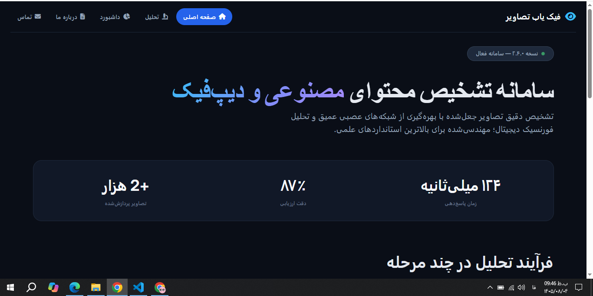
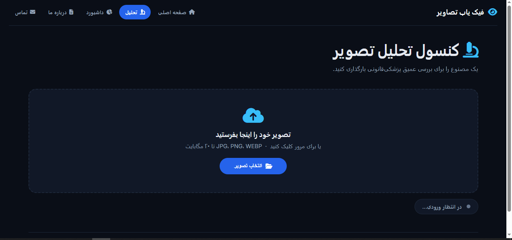
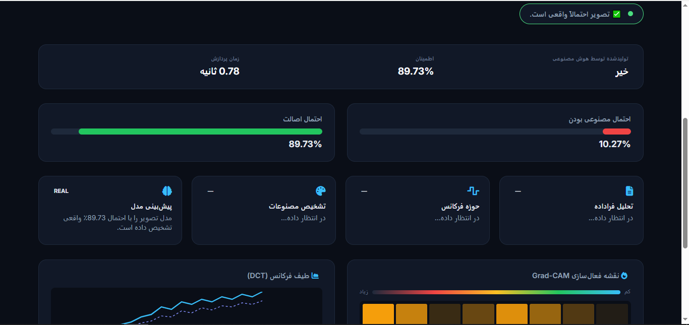
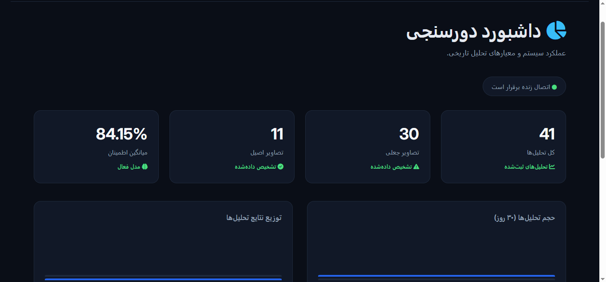

# FakeYab — AI Image Detection

FakeYab is an AI-powered web application designed to analyze images and help identify potentially fake or manipulated visual content using deep learning.

The application provides a web-based interface where users can upload images for analysis through an integrated deep learning model.

## 🌐 Overview

FakeYab combines Django backend development, image upload and validation, and deep learning model integration in a single web application.

The project explores the use of artificial intelligence and web technologies to support image authenticity analysis.

## ✨ Features

- **Image Upload:** Upload images through the web interface for analysis.
- **Image Validation:** Validate uploaded files before processing.
- **Deep Learning Integration:** Integrate a deep learning model into the image analysis workflow.
- **Web-Based Interface:** Access application features through Django-powered web pages.
- **REST API:** Provide an API endpoint for image analysis.
- **Dashboard:** Access the application's dashboard.
- **Informational Pages:** Include About and Contact pages.

## Screenshots

### Home Page

### Image Analysis

### Analysis Result

### Dashboard

## 🛠️ Technologies Used

- **Python** — Core programming language
- **Django** — Web framework and backend development
- **PyTorch** — Deep learning model integration and inference
- **Pillow** — Image handling and processing
- **SQLite** — Relational database
- **HTML** — Web page structure
- **CSS** — Styling and layout
- **JavaScript** — Client-side interactivity

## 🧠 How It Works

1. The user uploads an image through the web interface.
2. The application validates the uploaded file.
3. The image is passed to the integrated deep learning model for analysis.
4. The model's output is processed and the available result is presented to the user.

*Detection performance depends on the model, its training data, and the characteristics of the input images.*

## 👩‍💻 Developer

**Masoumeh Hoseini**

Computer Science Student | Web Development & Django

GitHub: [MHoseini-Developer](https://github.com/MHoseini-Developer)

---

*FakeYab — AI-assisted image authenticity analysis.*

---

# فیک‌یاب — سامانهٔ هوشمند تشخیص تصاویر جعلی

فیک‌یاب یک اپلیکیشن تحت وب مبتنی بر هوش مصنوعی است که با هدف تحلیل تصاویر و کمک به شناسایی تصاویر احتمالاً جعلی یا دست‌کاری‌شده، با استفاده از یادگیری عمیق توسعه داده شده است.

این سامانه بستری تحت وب فراهم می‌کند تا کاربران بتوانند تصاویر موردنظر خود را برای تحلیل، از طریق یک مدل یادگیری عمیق یکپارچه‌شده با برنامه ارسال کنند.

## 🌐 معرفی پروژه

فیک‌یاب، توسعهٔ بک‌اند با جنگو، بارگذاری و اعتبارسنجی تصاویر و اتصال مدل یادگیری عمیق را در قالب یک اپلیکیشن تحت وب ترکیب می‌کند.

هدف این پروژه، بررسی کاربرد هوش مصنوعی و فناوری‌های وب در تحلیل و اصالت‌سنجی تصاویر است.

## ✨ امکانات

- **بارگذاری تصویر:** ارسال تصاویر از طریق رابط کاربری برای تحلیل
- **اعتبارسنجی تصویر:** بررسی فایل‌های بارگذاری‌شده پیش از پردازش
- **اتصال مدل یادگیری عمیق:** یکپارچه‌سازی مدل هوش مصنوعی با فرایند تحلیل تصویر
- **رابط کاربری تحت وب:** دسترسی به امکانات سامانه از طریق صفحات مبتنی بر جنگو
- **رابط برنامه‌نویسی کاربردی (REST API):** فراهم کردن نقطهٔ پایانی برای تحلیل تصویر
- **داشبورد:** دسترسی به داشبورد سامانه
- **صفحات اطلاعاتی:** شامل صفحات دربارهٔ ما و تماس با ما

## تصاویر پروژه

### صفحه اصلی

### تحلیل تصویر

### نتیجه تحلیل

### داشبورد

## 🛠️ فناوری‌های استفاده‌شده

- **Python:** زبان اصلی برنامه‌نویسی
- **Django:** چارچوب توسعهٔ وب و پیاده‌سازی بک‌اند
- **PyTorch:** اتصال و اجرای مدل یادگیری عمیق
- **Pillow:** پردازش و مدیریت تصاویر
- **SQLite:** پایگاه دادهٔ رابطه‌ای
- **HTML:** ساختار صفحات وب
- **CSS:** طراحی ظاهری و چیدمان صفحات
- **JavaScript:** پیاده‌سازی تعاملات سمت کاربر

## 🧠 نحوهٔ عملکرد

۱. کاربر تصویر موردنظر خود را از طریق رابط کاربری بارگذاری می‌کند.

۲. سامانه فایل بارگذاری‌شده را اعتبارسنجی می‌کند.

۳. تصویر برای تحلیل به مدل یادگیری عمیق متصل‌شده به سامانه ارسال می‌شود.

۴. خروجی مدل پردازش شده و نتیجهٔ موجود به کاربر نمایش داده می‌شود.

*عملکرد تشخیص به مدل، داده‌های آموزشی آن و ویژگی‌های تصاویر ورودی وابسته است.*

## 👩‍💻 توسعه‌دهنده

**معصومه حسینی**

دانشجوی علوم کامپیوتر | توسعهٔ وب و بک‌اند جنگو

گیت‌هاب: [MHoseini-Developer](https://github.com/MHoseini-Developer)

---

*فیک‌یاب — تحلیل هوشمند اصالت تصاویر با کمک هوش مصنوعی.*